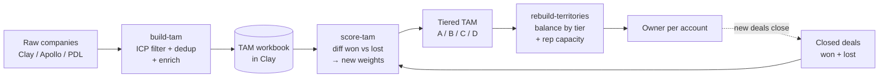

# tam-builder

**A self-refining market map. It builds the full list of companies you could sell to (your TAM), learns from closed deals which signals actually predict a win, re-scores every account against that, and rebalances rep territories by tier.**

Most target-account lists are a one-time pull that goes stale the week after. This one is a loop: every closed deal feeds back into the scoring model, so the list gets more accurate over time instead of decaying.



| | |
|---|---|
| **Runs in** | [Claude Code](https://claude.com/claude-code) as three skills, or each script standalone with `node` |
| **Dependencies** | None. Plain Node.js 20+ |
| **Data layer** | Clay workbook (via the Clay CLI / MCP) |
| **Tests** | `npm test`: filter, scoring and balancing logic against fixtures, no API calls |

## The three stages

### 1. `build-tam`: source → filter → dedup → enrich
[`dedup_filter.js`](.claude/skills/build-tam/scripts/dedup_filter.js) normalizes domains (`https://www.Acme.com/about` → `acme.com`), drops duplicates, and keeps only rows inside the ICP in [`config/icp.json`](config/icp.json): employee band, industry keywords, exclude keywords. It runs fully offline against a fixture, so you can check a filter change **before** spending enrichment credits.

```text
$ node .claude/skills/build-tam/scripts/dedup_filter.js -i examples/raw-companies.json -o filtered.json
{ "input_count": 9, "deduped_count": 7, "qualified_count": 3, "dropped_count": 4 }
```

Surviving rows are enriched in Clay (industry, headcount, tech stack, revenue) and written back with `qualified: true`. Rows that fail enrichment are flagged, never silently dropped.

### 2. `score-tam`: learn what predicts a win
[`signal_diff.js`](.claude/skills/score-tam/scripts/signal_diff.js) turns each closed deal into six normalized signals (0–1): employee band match, tech-stack overlap with past wins, hiring growth, company age, revenue band, sub-vertical match. For each signal it compares the won mean against the lost mean:

```
new_weight = clamp(1 + 2 × (mean_won − mean_lost), 0.1, 3.0)
```

Signals that separate winners from losers get heavier, and signals that don't fade out. Signals without data on both sides keep their current weight instead of being guessed. `--write` saves the new model to [`config/scoring-weights.json`](config/scoring-weights.json) with a version bump and the deal count it was trained on.

```text
$ node .claude/skills/score-tam/scripts/signal_diff.js --deals examples/closed-deals.json
employee_count_band_match: won_mean=1.00 lost_mean=0.50 -> weight 1 => 2
job_openings_growth: won_mean=0.72 lost_mean=0.48 -> weight 1 => 1.48
revenue_band_match: insufficient data (won=0, lost=0), weight unchanged
...
```

Every account is then re-scored and re-tiered (A–D cutoffs live in the same config).

### 3. `rebuild-territories`: fair books for every rep
[`balance.js`](.claude/skills/rebuild-territories/scripts/balance.js) walks tiers in priority order and round-robins accounts across reps with remaining capacity, so no rep ends up with all A-tier or all D-tier accounts. Overflow gets `owner: null` and is reported.

```text
$ node .claude/skills/rebuild-territories/scripts/balance.js -i examples/tiered-accounts.json -o assignments.json
Per-rep summary:
{ "Rep 1 (placeholder)": { "total": 3, "byTier": { "A": 1, "B": 1, "C": 1 } }, ... }
```

## Setup

1. Install the Clay plugin for Claude Code and authenticate it:
   ```bash
   claude plugin marketplace add clay-run/agent-plugins
   claude plugin install clay@clay-plugins
   ```
   Then run the `clay:setup` skill inside Claude Code.
2. Create a Clay workbook named **Industrial TAM** with a search source filtered to `config/icp.json`.
3. Edit the three config files for your market, scoring tiers and reps.
4. In Claude Code, run `/build-tam`, `/score-tam`, `/rebuild-territories`.

`.env.example` holds `CLAY_API_KEY` for the optional standalone client. `.env` is gitignored.

## Design decisions

- **Every external system sits behind one function.** CRM access lives only in `deals_adapter.js → getClosedDeals()` (currently a CSV stub). Swapping in Salesforce or HubSpot means changing one function body, nothing else.
- **No guessing at APIs.** `clay_client.js` throws a clear error until a confirmed request shape exists, instead of calling an endpoint that might not exist and failing silently.
- **Config over code.** ICP, weights, tiers and reps are JSON. Changing the market or the team never means editing a script.
- **The model is honest about small data.** With a handful of deals the weights are a check that the mechanism works, not a real model. The README and SKILL files say so.

## Roadmap

- [ ] Wire `getClosedDeals()` to a live CRM
- [ ] Schedule build → score → rebalance as a weekly cron
- [ ] Push owners into the CRM / sequencer, not just the Clay workbook

## Layout

```text
.claude/skills/
  build-tam/            SKILL.md + dedup_filter.js, clay_client.js
  score-tam/            SKILL.md + signal_diff.js, deals_adapter.js
  rebuild-territories/  SKILL.md + balance.js
config/                 icp.json, scoring-weights.json, territories.json
data/deals-stub.csv     CRM stand-in
examples/               fixtures used by the tests and the examples above
test/                   node:test suite
```

## License

MIT
